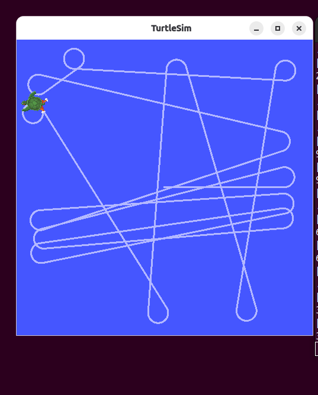
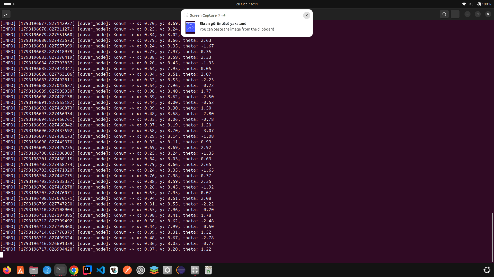

# turtle_duvar_py - Duvardan Kaçan Kaplumbağa

ROS 2 (rclpy) ve turtlesim ile yazılmış ödev paketi.

## Ne yapar?
1. `/turtle1/pose` konusunu dinleyip x ve y değerlerini alır.
2. `/turtle1/cmd_vel` konusuna `geometry_msgs/Twist` yayınlayarak kaplumbağayı ileri sürer.
3. x veya y değeri 1.0'dan küçük ya da 10.0'dan büyük olunca dönerek yön değiştirir.
4. Konumu saniyede bir `get_logger().info()` ile yazdırır.

## Bonus: Parametreler
| Parametre | Varsayılan | Açıklama |
|---|---|---|
| linear_speed | 1.5 | İleri hız |
| angular_speed | 2.0 | Dönüş hızı |
| min_limit | 1.0 | Alt sınır |
| max_limit | 10.0 | Üst sınır |

## Derleme
```bash
cd ~/ros2_odev
source /opt/ros/lyrical/setup.bash
colcon build --packages-select turtle_duvar_py
source install/setup.bash
```

## Çalıştırma
Terminal 1:
```bash
ros2 run turtlesim turtlesim_node
```
Terminal 2:
```bash
ros2 run turtle_duvar_py duvar_node
# Parametre ile:
ros2 run turtle_duvar_py duvar_node --ros-args -p linear_speed:=3.0 -p min_limit:=2.0
```

## Ekran Görüntüleri


